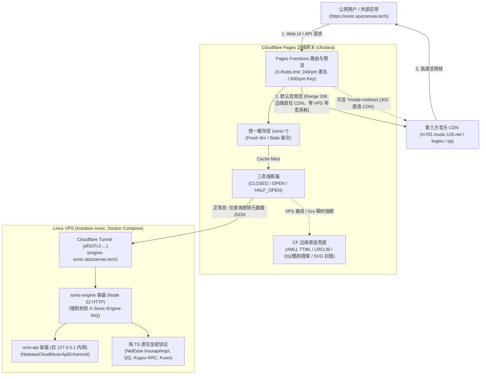

# 🎶 epocanvas sonic 多源聚合音乐云平台 & 网关 (v2.2.0 Linux 本地引擎版)

> 🌐 采用 **Linux VPS 本地协议解析引擎为主 + Cloudflare Pages Functions 边缘缓存与优雅降级为辅** 的控制面/数据面分离双层架构，配套现代化网页音乐播放器与 **epocanvas sonic 多源聚合网关**。具备本地原生加密协议解析（网易云 `linuxapi`/`eapi`/`ncm-api`、QQ `musicu.fcg`、酷狗 `KRC`、酷我原生检索）、三级熔断降级状态机与多语言毫秒级真逐字歌词。
> 
> 🟢 **当前线上主域名：[https://sonic.epocanvas.tech](https://sonic.epocanvas.tech)**（备用域：`https://sonic.epocanvas.com`；内部受保护引擎域：`https://engine-sonic.epocanvas.tech`）。

---

> [!IMPORTANT]
> **安全升级公告与 API Key 格式规范**：
> 1. **全量签名机制**：API Key 全面升级为 `sonic_live_v1.<payloadB64url>.<sigB64url>`（Payload: `{ v:1, email, exp, kid }`，签名使用 HMAC-SHA256 完整 32 字节哈希并经 base64url 编码，覆盖 `v1.<payloadB64url>`）。
> 2. **旧密钥废弃**：为杜绝无签名伪造漏洞，旧版密钥（`sonic_live_xxx_yyy` 和 `solara_live_*`）已彻底废弃拒绝。**所有用户需在上线后重新登录 Epomail 获取新版 API Key**。
> 3. **强密钥强制校验**：服务端环境变量 `SONIC_SECRET`（及 `SONIC_ENGINE_SECRET`）**长度必须 >= 32 字符**（推荐通过 `openssl rand -base64 48` 生成）；未配置或长度不足时网关一律执行 fail-closed 策略拒绝服务。
> 4. **Query 参数防护**：默认不再采纳 URL 查询参数 `?api_key=`，请使用请求头 `X-Sonic-Key`、`X-CFSolara-Key` 或 `Authorization: Bearer`。

---

## 🏛️ 双层同构架构与数据流 (Architecture)

系统采用 **控制面与数据面分离** 的同构微服务架构：Cloudflare Pages 承载用户流量入口与前端托管，高延迟的协议加密与直链反算交由 Linux VPS 本地解析引擎完成；音频数据流则由 Cloudflare 边缘节点直接向音乐 CDN 发起 `Range` 代理或 `302` 重定向，**不消耗 VPS 隧道带宽**。



---

## 🔍 "免费全曲 320kbps" 来源真实分布与溯源机制

本项目坚持**合规、真实溯源与零夸大**原则：

### 1. 真实来源与技术原理
- **网易云音乐 (`local-netease`)**：
  - **免费/公开曲目（`fee=0` 或 `fee=8`，如《起风了》等）**：通过内网 `ncm-api` 与纯 TS 实现的 `linuxapi`/`eapi` 协议直连官方接口，无需任何第三方上游与 VIP Cookie，直接获取官方 CDN 签发的 **320kbps 完整 MP3 直链**（单曲约 10~13 MB），支持 HTTP `Range: bytes=0-` 分段缓冲与 `206 Partial Content`；
  - **会员专享曲目（`fee=1`）**：在未注入个人合法会员 Cookie 时，返回官方公开的 30~45 秒试听片段（标明 `isTrial: true`，绝不以试听冒充全曲）；若在服务端 `.env` 注入个人合法 `NETEASE_COOKIE`，则按该账号的合法 VIP 权益解析完整流。
- **酷狗音乐 (`local-kugou`)**：
  - 对公开免费曲目（`privilege=0`）通过原生 `getSongInfo` 接口提取 `sharefs.kugou.com` 完整 MP3 流；KRC 歌词通过原生 XOR 解密与 Deflate 解压缩为真逐字歌词。
- **酷我音乐 (`local-kuwo`)**：
  - 原生提取公开曲目流，并在网关层严格拦截 `<250KB` 的 11 秒版权语音提示音假流（`/nf/resource/`）。
- **QQ 音乐 (`local-qq`)**：
  - 搜索、高清封面与 QRC/LRC 歌词 100% 原生可用；因海外机房 IP 限制，无损直链需配置 `QQ_COOKIE`。

### 2. 解析来源比例分布
| 音源类别 | 实际技术链路 | 默认请求占比 | 说明 |
| :--- | :--- | :---: | :--- |
| **本地自行解析 (`local-engine`)** | VPS 本地 Node 22 原生加密协议 + 内网 `ncm-api` 容器 | **> 90%** | 绝大多数公开曲目的 320kbps MP3、高清封面与 YRC/QRC/KRC 逐字歌词均由此自主解析 |
| **开源公共歌词库 (`amll` / `lrclib`)** | 直连 AMLL Timed Text XML API 与 LRCLIB 权威库 | **~ 10%** | 在本地原生歌词缺失或 VPS 降级时提供高精度逐字与全球同步歌词 |
| **第三方免费聚合上游 (`gdstudio` / `lyriva`)** | `music-api.gdstudio.xyz` / `api.lyriva.xyz` | **0%（默认严格关闭）** | `SONIC_ENABLE_GDSTUDIO=0`、`SONIC_ENABLE_LYRIVA=0`；仅供极端场景手动开启兜底 |
| **第三方解灰 / 绕过付费 (`unblock`)** | 任何 UnblockNeteaseMusic 变体 | **0%（默认严格关闭）** | 严格遵循版权边界，不集成解灰二进制，不开启付费越权 |

所有响应的 `meta.attempts[]` 均如实标明来源（如 `local-engine`、`local-netease`、`local-kugou`、`amll`、`lrclib`、`cf-direct`），绝不伪造或隐瞒提供方。

---

## ⚡ epocanvas sonic 多源聚合网关 (Gateway)

对外品牌统一为 **epocanvas sonic**，其中 `epocanvas` 为总品牌、`sonic` 为分品牌。技术命名空间（`/api/sonic/*`、`brand: "Sonic"`、`SONIC_*` 环境变量、`_sonic_*` 缓存参数等）属于冻结的兼容契约，不随展示品牌改名。


### 统一响应结构
所有 `/api/sonic/*` 接口遵循一致的顶层契约。`brand` 字段固定为 `"Sonic"`，用于兼容既有前端与第三方客户端（根索引接口 `GET /api` 同时输出顶层 `brand: "Sonic"` 与结构化品牌信息 `branding`，保证历史存量监控与新契约双向兼容）：
```json
{
  "brand": "Sonic",
  "data": { ... },
  "meta": {
    "cached": false,
    "cacheLevel": "none",
    "latencyMs": 142,
    "provider": "nexus",
    "degraded": false,
    "circuitState": "CLOSED",
    "attempts": [
      { "provider": "local-engine", "via": "local-engine", "source": "local-engine", "ok": true, "ms": 95 },
      { "provider": "local-netease", "via": "local-engine", "source": "local-engine", "ok": true, "ms": 78 }
    ]
  }
}
```

---

## 📡 API 路由清单 (sonic Routes)

### 1. 歌词网关 (`/api/sonic/lyrics/*`)

| 方法 | 路径 | 说明 | 优先级 / 行为 |
| :--- | :--- | :--- | :--- |
| `GET` | `/api/sonic/lyrics/nexus` | **全网聚合主入口（前端默认）** | ①平台原生 (YRC/QRC/KRC) → ②AMLL TTML → ③LRCLIB |
| `GET` | `/api/sonic/lyrics/netease` | 网易云原生歌词 | 优先原生 YRC 逐字，降级 LRC |
| `GET` | `/api/sonic/lyrics/qq` | QQ音乐原生歌词 | 优先原生 QRC 逐字，降级 LRC |
| `GET` | `/api/sonic/lyrics/kugou` | 酷狗音乐 KRC 歌词 | 自动 XOR 解密 + Deflate 解压真逐字 |
| `GET` | `/api/sonic/lyrics/amll` | AMLL TTML 歌词库 | 精准 Timed Text XML 字级时间轴 |
| `GET` | `/api/sonic/lyrics/lrclib` | LRCLIB 全球同步歌词 | 权威纯音乐预检与高质量行级同步 |
| `GET` | `/api/sonic/lyrics/apple` | Apple Music（可选适配） | 未配置密钥返回 `501 Not Implemented` + disabled |
| `GET` | `/api/sonic/lyrics/ytmusic` | YouTube Music（可选适配） | 未配置密钥返回 `501 Not Implemented` + disabled |
| `GET` | `/api/sonic/lyrics/lyriva` | Lyriva 第三方兜底（默认关闭） | 默认返回 `meta.disabled: true`；需显式开启 `SONIC_ENABLE_LYRIVA=1` |
| `GET` | `/api/sonic/lyrics/sync` | 外部组件多格式同步歌词 | 支持 `format=sonic\|lrc\|ttml\|json` |
| `GET` | `/api/sonic/lyrics` | **向后兼容端点** | 内部透明代理至 `/api/sonic/lyrics/nexus` |

### 2. 搜索、流解析与引擎网关 (`/api/sonic/*`)

| 方法 | 路径 | 说明 | 行为 |
| :--- | :--- | :--- | :--- |
| `GET` | `/api/sonic/search/nexus` | **全网多源并行搜索（前端默认）** | 优先调用 Linux 本地引擎；降级时 `Promise.allSettled` 边缘直连，归一化合并 `sources[]` |
| `GET` | `/api/sonic/search/smart` | **智能混合搜索与实时补全建议** | 支持简繁归一、拼音/首字母、歌手中英文别名、拼写容错、版本识别、相关性门控个性化与零结果兜底 |
| `GET` | `/api/sonic/recommend/for-you` | **猜你喜欢 / Auto DJ / 相似电台** | 融合完播、收藏、搜索点击、内容相似与 MMR 多样性重排的可解释推荐 |
| `GET` | `/api/sonic/recommend/trending` | **站内真实趋势热榜 (`24h`/`7d`/`surging`/`new`)** | 严格区分站内真实有效播放 (`cfsolara-internal`) 与外部榜单参考 (`external-chart`)，内置单用户对数防刷与时间衰减 |
| `GET` | `/api/sonic/recommend/similar` | **内容相似歌曲与相似歌手推荐** | 基于歌手关系图谱、流派/语言/专辑特征余弦与会话共现图计算相似曲目 |
| `GET` | `/api/sonic/recommend/discover` | **风格流派与温度探索雷达** | 支持流派筛选与 `temperature` 探索尺度调节 |
| `POST/DELETE` | `/api/sonic/events` | **隐私优先的行为反馈与一键重置** | 采集播放/收藏/不喜欢信号（自动过滤网络卡顿与 30s 试听截断），支持 `DELETE` 一键清空画像 |
| `GET` | `/api/sonic/search/netease` | 网易云单源搜索 | 原生 `ncm-api` / `linuxapi` 检索，返回统一 Track 结构 |
| `GET` | `/api/sonic/search/qq` | QQ音乐单源搜索 | 原生 `u.y.qq.com` 检索，返回统一 Track 结构 |
| `GET` | `/api/sonic/search/kugou` | 酷狗音乐单源搜索 | 原生检索，返回统一 Track 结构 |
| `GET` | `/api/sonic/search/kuwo` | 酷我音乐单源搜索 | 原生检索（含 181KB 版权提示音假流过滤） |
| `GET` | `/api/sonic/search/gdstudio` | GDStudio 第三方兜底（默认关闭） | 默认返回 `meta.disabled: true`；仅当 `SONIC_ENABLE_GDSTUDIO=1` 时启用 |
| `GET` | `/api/sonic/forward` | 统一聚合与防盗链资源转发 | 支持搜索、歌词与受 SSRF 保护的媒体资源代理 |
| `GET` | `/api/sonic/resolve/stream` | 本地引擎流直链解析（内部鉴权） | 强制校验 `X-Sonic-Engine-Key`，供边缘网关缓存直链元数据 |
| `GET` | `/api/sonic/engine/health` | 本地引擎健康与熔断诊断（内部鉴权） | 强制校验 `X-Sonic-Engine-Key`，匿名访问返回 `401` |

### 3. 媒体与商业曲库路由 (`/api/music/*` & `/api/[[path]]`)

| 方法 | 路径 | 说明 | 行为 |
| :--- | :--- | :--- | :--- |
| `GET` | `/api/music/stream` | 音频流分段代理 | 支持 `Range: bytes=...`，返回 `206 Partial Content`；支持 `?mode=redirect` 直连 |
| `GET` | `/api/music/cover` | 专辑与歌手封面 | 优先解析高清原图，失败平滑降级为品牌 SVG 矢量占位图 |
| `GET` | `/api/music/palette` | 封面主色调分析 | 计算前端播放器背景毛玻璃主色与对比度渐变 |
| `GET` | `/api/music/random` | 随机曲库推荐 | 支持按风格流派随机抽取推荐曲目 |
| `GET` | `/api/[[path]]` | 首页/歌单/榜单/歌手 | 透传本地引擎曲库数据，脱敏第三方品牌字样 |

---

## 🛡️ 容灾与降级状态机 (Fault Tolerance)

系统内置三态熔断器（`CLOSED` 正常 / `OPEN` 熔断 / `HALF_OPEN` 探活），提供电信级高可用；所有网关开关与外链均使用 `SONIC_` 前缀（技术命名空间，保留不变），支持单源开关：

1. **瞬时熔断**：当 VPS 离线、出现 Tunnel `530` / `502` 或连续 3 次超时（预算 `4.5s`）时，熔断器立即进入 `OPEN` 状态；
2. **0ms 快速跳过**：后续请求不再白等死亡隧道，耗时 `0ms` 立即切入 Cloudflare 边缘降级层：
   - 首页与 Web SPA：秒开加载，绝不白屏或报 Cloudflare 1033；
   - 搜索与歌词：由 CF 边缘直连 QQ/酷狗与 AMLL/LRCLIB 提供服务，响应头携带 `X-Sonic-Degraded: 1`；
   - 前端体验：播放器顶部自动展示琥珀色胶囊 **“边缘降级模式 · 本地解析后端暂时离线”**；
   - 未命中缓存的音频流：返回清晰的结构化 `503`（`code: "STREAM_UNAVAILABLE_DEGRADED"`），前端提示服务降级并停止自动跳歌风暴，与常规 `404` 严格区分；
3. **自动恢复**：冷却时间（默认 30s）结束后，熔断器进入 `HALF_OPEN` 发送单次健康探测，VPS 恢复后自动闭合（`CLOSED`），前端胶囊无感消失。

---

## 🛠️ 部署与运维指南 (Deployment Guide)

### 1. Cloudflare Pages 边缘网关部署
```bash
# 1. 构建前端与服务端
npm run build

# 2. 部署至 Cloudflare Pages (已配置环境变量 SONIC_LOCAL_ENGINE_URL 与 SONIC_ENGINE_SECRET)
npx wrangler pages deploy dist --project-name cfsolara
```

### 2. Linux VPS 本地解析引擎部署
```bash
# 1. 构建本地引擎单文件
npm run build:server

# 2. 在 VPS /data/workspace/CFSolara 启动 Docker Compose 栈
docker compose up -d --build

# 3. 检查容器健康状态
docker compose ps
```

### 3. 环境变量参考 (`.env.example`)
```ini
# 1. 服务间通信与内部鉴权 (Pages -> VPS Engine)
SONIC_LOCAL_ENGINE_URL="https://engine-sonic.epocanvas.tech"
SONIC_ENGINE_SECRET="<your_strong_random_secret>" # 长度必须 >= 32 字符 (openssl rand -base64 48)

# 2. 用户认证与 API Key 签名密钥 (REQUIRED)
# 采用全量 HMAC-SHA256 签名，生成方式：openssl rand -base64 48 (长度必须 >= 32 字符)
SONIC_SECRET="<your_strong_sonic_secret>"
# 可选旧密钥轮换（用于过渡期间验签旧 Key）：
# SONIC_SECRET_PREV=""
# 是否允许 URL Query 参数传递 api_key (默认 0 禁用；警告：开启后密钥会进入服务端日志与 HTTP Referer)
SONIC_ALLOW_QUERY_KEY="0"

# 3. Epomail OAuth 2.0 配置 (缺失返回 503)
EPOMAIL_BASE_URL="https://mail.epocanvas.com"
EPOMAIL_CLIENT_ID=""
EPOMAIL_CLIENT_SECRET=""
SONIC_ALLOWED_ORIGINS="https://sonic.epocanvas.tech,https://sonic.epocanvas.com"

# 4. 本地原生协议音源开关 (1 启用, 0 禁用)
SONIC_ENABLE_NETEASE="1"
SONIC_ENABLE_QQ="1"
SONIC_ENABLE_KUGOU="1"
SONIC_ENABLE_KUWO="1"
SONIC_ENABLE_AMLL="1"
SONIC_ENABLE_LRCLIB="1"
SONIC_ENABLE_FREE_MATCH="1"

# 5. 第三方免费聚合与 VIP 解灰 (默认严格关闭)
SONIC_ENABLE_GDSTUDIO="0"
SONIC_ENABLE_LYRIVA="0"
SONIC_ENABLE_UNBLOCK="0"

# 6. 可选用户自有会员 Cookie (仅存 VPS 服务端 .env，严禁下发前端)
NETEASE_COOKIE=""
QQ_COOKIE=""
KUGOU_COOKIE=""
```

### 4. 生产环境双轨回滚预案 (Rollback Guide)
当发生极端故障需完整恢复至原始直连 VPS Tunnel 架构时，可运行内置回滚脚本：
```bash
# 1. 验证备份完整性并展示将要发送的 API 请求 (干跑验证，默认安全模式)
./scripts/rollback-production.sh --dry-run

# 2. 真实执行回滚 (恢复 Tunnel Ingress 路由与 DNS CNAME 记录)
./scripts/rollback-production.sh --execute
```

---

## 💖 致谢与开源协议参考 (Credits)

本专案的 epocanvas sonic 多源聚合网关借鉴并致谢以下优秀的开源专案与协议实现：

- **Meting**：https://github.com/metowolf/Meting
- **Meting-API-Serverless**：https://github.com/Warma10032/Meting-API-Serverless
- **ourcraft-music-api**：https://github.com/Yuncan050115/ourcraft-music-api
- **music-lib**：https://github.com/guohuiyuan/music-lib
- **go-music-api**：https://github.com/guohuiyuan/go-music-api
- **NeteaseCloudMusicApi**：https://github.com/Binaryify/NeteaseCloudMusicApi
- **QQMusicApi**：https://github.com/jsososo/QQMusicApi
- **AMLL (Timed Text XML API)**：https://github.com/amll-dev/amll-ttml-api
- **LRCLIB (Synced Lyrics)**：https://lrclib.net/docs
- **GDStudio Music API**：https://music-api.gdstudio.xyz/api.php
- **Linux.do 社区**：牛就是牛 @ufoo 大佬灵感提供

---

## 📄 许可证与版权 (Copyright & License)
Copyright © 2026 epocanvas. All rights reserved.

本项目采用 CC BY-NC-SA 协议，禁止商业化转售行为，任何衍生项目必须保留本项目地址并以相同协议开源。
