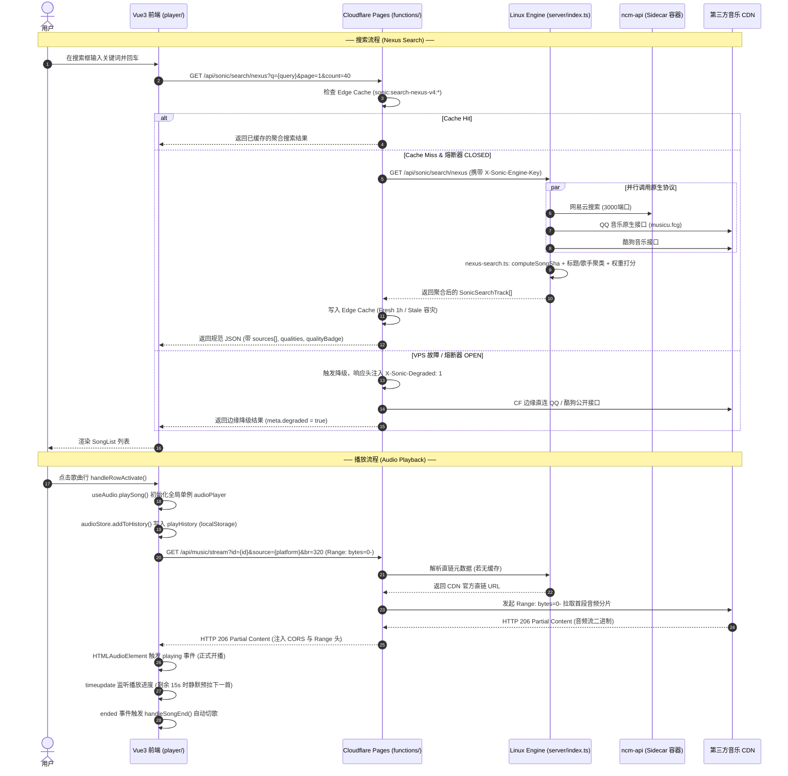

# CFSolara 智能推荐工程：阶段 1 — 仓库现状核验与基线报告

> **文档状态**：已核验 (Verified)  
> **核验日期**：2026-10-24  
> **执行阶段**：阶段 1（事实核验、代码定位与基线交接，无算法开发与业务代码修改）  
> **项目分支**：`security/fix-auth-ratelimit-ssrf`  
> **代码库**：`shijianus/CFSolara`

---

## 1. 实际工程目录与技术栈

### 1.1 拓扑架构概览
CFSolara 采用**双层分布式同构微服务架构**：
- **控制面 / 边缘接入层**：Cloudflare Pages + Pages Functions（承载公网访问、静态资源托管、边缘缓存、请求鉴权、三态熔断与优雅降级）。
- **数据面 / 本地协议解析引擎**：Linux VPS（运行 Docker Compose 容器栈，处理高延迟的各平台原生加密协议与反算，音频流直接由边缘直拉第三方 CDN，不消耗 VPS 隧道带宽）。
- **前端 Web 播放器**：基于 Vue 3 + Vite 的现代化 SPA（源码位于 `player/`），编译后输出至 `dist/`，同时被 Cloudflare Pages 和 VPS 本地引擎静态托管。

```
CFSolara/
├── server/                     # Linux VPS 本地 Node.js 22 HTTP 服务封装
│   └── index.ts                # VPS 本地引擎真实入口 (单文件 esbuild 打包入口)
├── functions/                  # Cloudflare Pages Functions 路由与边缘逻辑
│   ├── _lib/                   # 共享核心逻辑 (TS)，在 CF Functions 与 Node.js 引擎间 100% 同构复用
│   │   ├── auth.ts             # Epomail OAuth 2.0 PKCE 与 HMAC-SHA256 API Key
│   │   ├── brand.ts            # 品牌与脱敏规范
│   │   ├── http.ts             # Web 标准 Response/Headers 工具
│   │   ├── music.ts            # 基础音乐搜索、取流与伪随机函数
│   │   ├── sonic/              # Sonic 多源聚合网关核心实现
│   │   │   ├── cache.ts        # 三级缓存 (LRU 内存 / CF Edge Cache / KV)
│   │   │   ├── config.ts       # 网关配置解析与环境变量管理
│   │   │   ├── crypto.ts       # 纯 TS 实现的 MD5、AES-128-ECB 与平台加解密
│   │   │   ├── local-engine.ts # Pages 到 VPS Engine 的 HTTP 客户端与三态熔断器
│   │   │   ├── native-protocols.ts # 网易云 linuxapi/eapi、酷狗 KRC 解密
│   │   │   ├── nexus-lyrics.ts # 多源逐字歌词调度器
│   │   │   ├── nexus-search.ts # 多源多属性聚类去重搜索核心 (Nexus Search)
│   │   │   ├── providers/      # 各平台适配器 (netease, qq, kugou, kuwo, amll, lrclib...)
│   │   │   ├── route-helpers.ts# 路由请求拦截、解析与响应包装
│   │   │   ├── security.ts     # SSRF 校验、滑动窗口限流与 Engine Key 鉴权
│   │   │   ├── types.ts        # 网关统一类型定义
│   │   │   └── upstream.ts     # 网易云商业曲库代理与脱敏 (首页/榜单/歌单)
│   │   └── types.ts            # 全局 AppEnv 与 Track 类型
│   └── api/                    # Pages Functions 路由端点
│       ├── [[path]].ts         # 捕获 /api/* 商业曲库路由
│       ├── auth/               # 鉴权路由 (login, callback, key, user)
│       ├── music/              # 媒体路由 (stream, lyric, cover, palette, random)
│       └── sonic/              # Sonic 核心网关路由 (search, lyrics, engine, forward)
├── player/                     # 现代前端播放器应用源码
│   ├── src/
│   │   ├── api/                # 前端 API 请求层 (interface.ts, index.ts)
│   │   ├── components/         # 播放器组件 (SongList, PlayerDrawer, Search...)
│   │   ├── composables/        # 组合式函数 (useAudio.ts, useLyrics.ts...)
│   │   ├── pages/              # 桌面端页面 (index.vue, search.vue, song.vue, charts.vue...)
│   │   ├── pages/mobile/       # 移动端页面 (index.vue, search.vue, song.vue...)
│   │   ├── stores/             # Pinia 状态管理 (audio.ts, library.ts, global.ts, persist.ts)
│   │   └── utils/              # 前端工具 (indexedDB.ts, transformers.ts, audioUtils.ts)
│   ├── package.json            # 前端依赖配置 (Vue 3.5, Vite 7, Pinia 3, Tailwind 4)
│   └── tests/                  # 前端单元测试 (Vitest)
├── dist/                       # 前端编译输出目录 (由 player/ 编译后拷贝生成)
├── dist-server/                # VPS 服务端单文件编译产物 (dist-server/index.mjs)
├── docker-compose.yml          # VPS 端 Docker Compose 配置 (sonic-engine + ncm-api)
├── Dockerfile                  # sonic-engine 多阶段构建 Dockerfile (Node 22 Alpine)
├── Dockerfile.ncm              # ncm-api 网易云协议 Sidecar Dockerfile
├── .env.example                # 环境变量配置模板
├── package.json                # 根目录构建与测试命令
├── tests/                      # 根目录测试套件 (tests/security.test.ts)
└── js/ & css/ & index.html     # ⚠️ 历史遗留单文件播放器 (非当前生产主力前端，详见后文说明)
```

### 1.2 关键技术栈
| 层次 | 选型与版本 | 职责 |
| :--- | :--- | :--- |
| **Edge Serverless** | Cloudflare Pages Functions (V8 Isolate) | 边缘轻量网关、缓存调度、熔断降级、OAuth 与 API 鉴权 |
| **VPS Node.js** | Node.js 22 (Alpine 容器 / ESM) | 执行本地纯 TS 加密协议、本地 NCM Sidecar 通信、静态文件托管 |
| **构建打包** | esbuild 0.25 (服务端) / Vite 7.1 (前端) | 服务端打为零依赖单文件 `index.mjs`，前端 SPA 打包 |
| **前端框架** | Vue 3.5 + TypeScript 5.9 + Pinia 3.0 | 响应式音频播放控制、曲库渲染、UI 状态管理 |
| **样式与动效** | Tailwind CSS 4.1 + GSAP 3.13 + Swiper 12 | 玻璃拟态毛玻璃主题、轮播图、转盘动效 |
| **本地持久化** | `localStorage` (Pinia persistedstate) + `IndexedDB` (v2) | 用户收藏、播放历史、下载歌曲文件与本地音频持久化 |
| **测试框架** | Vitest 5.0 + Jiti (TS 脚本即时运行) | 安全审计、鉴权兼容性、降级演练、前端 Store 单元测试 |

---

## 2. 真实代码核验：已有能力 vs 文档描述 vs 缺失功能

### 2.1 【已实现】并在代码中定位的能力
1. **VPS Node.js 服务真实入口**：
   - 源码位置：`server/index.ts`
   - 实现：`createSonicServer()` 函数创建原生 Node.js HTTP 服务器，使用 `toWebRequest()` 将 `http.IncomingMessage` 转换为标准 `Request`，并将路由 1:1 分发至 `functions/` 对应的 Pages Functions 处理函数。未匹配 API 时通过 `serveStaticAsset()` 托管 `dist/` 静态文件，SPA 路由回退至 `dist/index.html`。
2. **跨平台多源并行聚合与去重搜索 (`/api/sonic/search/nexus`)**：
   - 源码位置：`functions/api/sonic/search/nexus.ts` -> `functions/_lib/sonic/route-helpers.ts:handleNexusSearchRequest` -> `functions/_lib/sonic/nexus-search.ts:searchNexus`
   - 实现：
     - 并行拉取网易云 (`neteaseProvider`)、QQ音乐 (`qqProvider`)、酷狗音乐 (`kugouProvider`)；
     - 使用 `computeSongSha` 计算哈希，使用 `cleanTitleForMatching` 和 `cleanArtistForMatching` 清理括号、伴奏、Remaster 等噪点，并结合时长差 <= 6 秒进行聚类（Track Clustering）；
     - 聚类后的歌曲合并其跨平台来源到 `sources[]`（记录 `platform` 与 `platformId`）；
     - 综合计算匹配度得分（精准匹配 + 跨源重复出现共识度加分 + 原始榜单热度加分 + SQ/HQ 音质加分）后倒序返回。
3. **音频流分段代理与直链 (`/api/music/stream`)**：
   - 源码位置：`functions/api/music/stream.ts` -> `functions/_lib/music.ts:getAudioStreamUrl`
   - 实现：支持 HTTP `Range: bytes=start-end`，返回 `206 Partial Content`，直接通过 Cloudflare 边缘代理拉取目标音乐 CDN，并注入 CORS 头；同时支持 `?mode=redirect` 返回 302 重定向。
4. **多格式高精度逐字歌词 (`/api/sonic/lyrics/nexus`)**：
   - 源码位置：`functions/api/sonic/lyrics/nexus.ts` -> `functions/_lib/sonic/nexus-lyrics.ts:getLyricsNexus`
   - 实现：调度网易云 YRC、QQ 音乐 QRC、酷狗 KRC（原生 XOR 解密 + Deflate 解压）、AMLL TTML、LRCLIB，提供毫秒级字级同步结构 `words: [{ word, start, end }]`。
5. **三态熔断与边缘降级机制**：
   - 源码位置：`functions/_lib/sonic/local-engine.ts` (熔断器状态机) 与 `functions/_lib/sonic/cache.ts` (多层缓存)
   - 实现：三态熔断器 (`CLOSED` / `OPEN` / `HALF_OPEN`)。当 VPS 离线、出现 Tunnel 530/52x 或连续 3 次超时（4.5s 预算）时瞬时触发 `OPEN`，耗时 0ms 快速失败跳过 VPS，由 Cloudflare 边缘直连 QQ/酷狗与公网歌词库，响应头标注 `X-Sonic-Degraded: 1`。不可用音频流返回显式 `503 STREAM_UNAVAILABLE_DEGRADED` 阻止前端死循环跳歌。
6. **无状态全量签名鉴权体系**：
   - 源码位置：`functions/_lib/auth.ts` 与 `functions/_lib/sonic/security.ts`
   - 实现：Epomail OAuth 2.0 PKCE 流程；签发基于 HMAC-SHA256 的全量无状态 API Key `sonic_live_v1.<payloadB64url>.<sigB64url>`；服务端强制校验密钥长度 `>= 32` 字符；基于 `CF-Connecting-IP` 进行滑动窗口限流。
7. **客户端本地持久化与离线曲库**：
   - 源码位置：`player/src/stores/modules/audio.ts`, `player/src/stores/modules/library.ts`, `player/src/utils/indexedDB.ts`
   - 实现：通过 `pinia-plugin-persistedstate` 将播放状态、收藏歌曲、历史记录落盘到 `localStorage`；IndexedDB（`SonicMusicPlayerDB`）持久化存储本地音频和已下载音频 Blob。

---

### 2.2 【文档描述但实为代理/伪随机】的能力
1. **随机推荐曲库 (`/api/music/random`)**：
   - 源码位置：`functions/api/music/random.ts` -> `functions/_lib/music.ts:getRandomTracks`
   - **真实代码揭秘**：
     ```typescript
     export async function getRandomTracks(env: AppEnv, count = 10, genre?: string): Promise<SongItem[]> {
       const GENRES = ['流行', '古典', '民谣', '摇滚', '爵士', '纯音乐', 'ACG', '轻音乐'];
       const targetGenre = genre || GENRES[Math.floor(Math.random() * GENRES.length)];
       const page = Math.floor(Math.random() * 3) + 1;
       const tracks = await searchTracks(env, targetGenre, 'netease', count, page);
       return tracks.sort(() => Math.random() - 0.5);
     }
     ```
   - **事实核验**：这并不是真正的推荐算法，而是一个**基于预设固定流派词的普通搜索与伪随机洗牌包装器**。没有任何特征提取、用户喜好学习或协同过滤逻辑。
2. **首页推荐歌单、热门新歌、歌手 (`/api/top/*`, `/api/personalized/*`)**：
   - 源码位置：`functions/api/[[path]].ts` -> `functions/_lib/sonic/upstream.ts:handleUpstreamEndpoint`
   - **事实核验**：均直接代理至网易云音乐公开接口（如 `https://music.163.com/api/playlist/highquality/list`、`https://music.163.com/api/v1/discovery/new/songs`、`https://music.163.com/api/toplist/detail`），并在网关层对“网易云音乐”等品牌字样进行脱敏替换。数据属于外部公网榜单，无个性化推荐。
3. **“探索雷达”**：
   - 历史代码：根目录旧版原生脚本 `js/index.js:52` 中存在 `getRadarPlaylist: async (playlistId = "3778678")`，其本质是将网易云热歌榜（ID `3778678`）的数据拉取后伪装为雷达歌单。
   - 现代前端：在当前生产环境使用的 Vue 3 播放器（`player/src`）中，**完全没有“探索雷达”相关组件或调用**。

---

### 2.3 【当前没有实现】的能力
1. **服务端用户行为采集管道**：没有接收点击事件、播放时长、切歌/跳过行为、搜索转化的上报 API 端点。
2. **持久化数据库**：服务端没有配置 Cloudflare D1、SQLite、PostgreSQL 或任何 ORM 库，完全处于“无状态/无持久化存储”状态。
3. **匿名用户追踪与会话标识**：未登录用户未下发匿名 `uuid` Cookie，服务端无法在多次访问间关联同一匿名用户。
4. **定时计算与离线更新任务**：无 Cloudflare Scheduled Workers (Cron Triggers)，无后台定时跑批任务。
5. **推荐模型与算法引擎**：无协同过滤、无基于内容的召回、无向量召回、无打分排序模块。

---

## 3. 推荐系统接入条件深度核验

| 核验项 | 核验结论 | 真实代码依据与细节分析 |
| :--- | :---: | :--- |
| **当前是否已有用户行为记录？** | **仅限客户端** | 前端 `audio.ts:1215` (`addToHistory`) 记录最多 100 首播放历史到 `localStorage`；`library.ts:106` 记录收藏歌曲及 `likedAt`。服务端**无任何**行为日志。 |
| **是否能识别一首歌真正开始播放？** | **可以识别** | `player/src/stores/modules/audio.ts:338` 监听了原生 `HTMLAudioElement` 的 `playing` 事件。该事件在音频完成缓冲并真正发声时触发。 |
| **是否能取得播放完成、切歌和收藏事件？** | **可以取得** | 1. 播放完成：`audio.ts:314` 监听 `ended` 事件并触发 `handleSongEnd()`；<br/>2. 切歌：`audio.ts:430` 计算 `isSwitchingSong`，且 `nextSong()`/`previousSong()` 触发明确切歌；<br/>3. 收藏事件：`library.ts:100` 的 `toggleLikeSong()` 明确捕获收藏与取消。 |
| **能否记录搜索后点击了哪首歌？** | **当前无记录** | `player/src/components/Search/SearchSongs.vue` 在得到搜索结果后交由 `SongList.vue` 渲染，点击仅触发常规播放，未携带并记录“来自搜索词 query 的第 N 项点击”行为。 |
| **是否有数据库保存歌曲资料和反馈？** | **完全没有** | 服务端 `AppEnv` 仅有可选的 `KV?: any`（用于缓存），无 `env.DB`（D1）绑定；Docker Compose 中无数据库服务；客户端仅有 `localStorage` 与 `IndexedDB`。 |
| **歌曲对象元数据完整性** | **完备** | 前端 `Song` 与后端 `SonicSearchTrack` 均包含：歌名 (`name/title`)、歌手 (`artist`)、专辑 (`album`)、时长 (`duration`)、来源 (`platform/sources`)、播放状态 (`streamType`: `'full'\|'trial'\|'unavailable'`)、品质徽章 (`qualityBadge`: `'SQ'\|'HQ'`)。 |
| **不同平台的同一歌曲是否已去重？** | **聚合搜索已去重** | `functions/_lib/sonic/nexus-search.ts` 实现了歌曲标题规范化、歌手分离、时长比对和 SHA 聚类，并在 `sources[]` 中归一化各平台 ID；但单源接口未做跨平台去重。 |
| **当前是否有热门榜或定时更新任务？** | **有榜单，无定时任务** | 有网易云公开榜单代理 (`GET /api/toplist/detail`)；但**完全没有**定时任务 (Cron/Queue)。 |
| **前端适合集成推荐内容的页面** | **四处黄金位置** | 1. **首页 (`player/src/pages/index.vue`)**：Banner 下方新增“个性化推荐/猜你喜欢”瀑布流；<br/>2. **播放器抽屉 (`player/src/components/PlayerDrawer.vue`)**：转盘/歌词下方新增“相似曲目推荐”；<br/>3. **搜索页 (`player/src/pages/search.vue`)**：搜索空白页与搜索结果末尾推荐；<br/>4. **我喜欢的音乐 (`player/src/pages/likes.vue`)**：顶部增加“基于收藏的心动模式”。 |
| **最适合复用的已有 API** | **极高复用度** | 1. `/api/sonic/search/nexus`：已有高精度聚类去重搜索；<br/>2. `/api/music/stream`：标准 Range 206 流分段代理；<br/>3. `/api/music/cover` & `/api/music/palette`：封面与毛玻璃背景主题色提取；<br/>4. `functions/_lib/sonic/nexus-search.ts` 中的 `computeSongSha`、`cleanTitleForMatching`：可直接用作推荐系统歌曲特征提取。 |
| **Cloudflare 与 VPS 鉴权与缓存机制** | **已高度完备** | 1. 鉴权：CF 向 VPS 发起请求必须携带 `X-Sonic-Engine-Key`，VPS 强制校验且密钥长度 `>=32`，未授权直接 401；<br/>2. 缓存：三层缓存（内存 LRU -> Edge Cache -> Workers KV），支持 stale 容灾降级。 |

---

## 4. 搜索与播放的核心数据流图



---

## 5. 现有运行环境与构建测试核验

### 5.1 环境版本
- **Node.js**：`v22.18.0`（系统安装版本，符合 `>=22` 要求）
- **包管理器**：`pnpm 12.4.2`、`npm 11.5.1`
- **Docker**：`Docker 29.6.1`，`Docker Compose v5.3.1`
- **Git 状态**：
  - 当前分支：`security/fix-auth-ratelimit-ssrf`
  - 远端追踪：`origin/security/fix-auth-ratelimit-ssrf`
  - 工作区状态：**无未提交修改（Working tree clean）**

### 5.2 核心构建与测试命令验证
所有命令均在本地实际执行通过：
```bash
# 1. 编译 Linux VPS 本地解析引擎单文件 (耗时约 37ms，输出 dist-server/index.mjs，大小约 425KB)
npm run build:engine

# 2. 编译前端 Vue 3 Web 播放器 (输出至 player/dist 并拷贝至 dist/)
npm run build

# 3. 运行根目录安全测试套件 (Vitest: 15/15 全部通过)
npm run test:security

# 4. 运行鉴权兼容性测试套件 (Jiti: 36/36 全部通过)
npm run test:auth

# 5. 运行本地引擎与降级演练测试套件 (Jiti: 47/47 全部通过)
npm run test:engine

# 6. 运行前端播放器单元测试 (Vitest: 6 个文件，27/27 全部通过)
cd player && pnpm test
```

---

## 6. 推荐系统集成设计指引与潜在风险

### 6.1 潜在兼容性风险与架构红线
1. **服务端环境异构性（Node.js vs Cloudflare Workers Isolate）**：
   - `functions/` 目录下的代码必须保持 **Edge Runtime 纯 JS/TS 兼容**，严禁引入仅限 Node.js 的 C++ 原生模块（如 `better-sqlite3`、`node-canvas`）、本地文件系统访问（`fs`）或特定操作系统二进制。
   - 任何新增的推荐模块若放入 `functions/_lib/`，必须使用 Web Standard API（`fetch`、`crypto.subtle`、`Headers`、`Response`）。
2. **“无状态微服务”架构契约限制**：
   - CFSolara 的核心设计理念之一是**服务端无状态、零数据库维护成本**。
   - 如果推荐系统必须记录用户画像，必须审慎决策：
     - **方案 A（轻量纯客户端推荐）**：完全基于前端 `localStorage` 中的 `playHistory`、`likedSongs`、`searchHistory`，在客户端计算偏好标签（如歌手偏好、风格分布），再复用 `/api/sonic/search/nexus` 检索候选集并混排；
     - **方案 B（Cloudflare 原生无状态/Serverless 方案）**：利用 Cloudflare Workers KV 或 Cloudflare D1 存储用户画像向量/行为记录；
     - **方案 C（VPS 本地轻量化存储）**：在 VPS Docker Compose 中挂载 SQLite / DuckDB，通过 `server/index.ts` 提供行为收集与推荐打分接口。
3. **两套前端代码的干扰**：
   - 仓库根目录保留有历史遗留的 `index.html`、`js/index.js`、`css/style.css`。
   - **注意**：生产环境构建流程完全以 `player/` 源码为准，部署时直接打包 `player/dist` 覆盖到 `dist/`。后续模型开发推荐 UI 时，**只能修改 `player/` 下的 Vue 组件，切勿修改根目录的历史静态文件**。
4. **弱密钥与配置 Fail-Closed 机制**：
   - 现存安全规则强制要求 `SONIC_SECRET` 与 `SONIC_ENGINE_SECRET` 长度 `>= 32`。若未配置或长度不足，鉴权模块会直接中断。新推荐端点若涉及内部鉴权，必须遵循既有安全守则。

---

## 7. 后续模型推荐优先阅读的文件清单

后续接手算法与集成的模型，请**严格按照以下优先级顺序**阅读代码：

1. `player/src/stores/modules/audio.ts`
   - **理由**：播放器核心状态机，控制播放开始 (`playSong`)、真实发声 (`playing`)、播放历史记录 (`addToHistory`)、播放结束 (`ended`/`handleSongEnd`)、切歌预加载 (`preloadNextTrack`)。是推荐算法捕获用户正向/负向反馈事件的核心集成点。
2. `functions/_lib/sonic/nexus-search.ts`
   - **理由**：包含完整的歌曲哈希计算 (`computeSongSha`)、歌曲名称/歌手清洗规则 (`cleanTitleForMatching`)、多源聚类逻辑与权重打分函数，是跨源候选歌曲匹配与相似度比对的黄金模板。
3. `player/src/stores/interface.ts`
   - **理由**：定义了播放器全流程通用的数据类型（`Song`、`Artist`、`AudioStoreState`、`GlobalState`），添加推荐字段（如 `recommendReason`、`matchScore`）时必须与该文件兼容。
4. `player/src/pages/index.vue`
   - **理由**：前端首页入口，包含 Banner、歌单、新歌的拉取与渲染方式（`loadData()` 中的 `Promise.allSettled`），是推荐卡片/流的最直接挂载点。
5. `functions/_lib/sonic/upstream.ts`
   - **理由**：商业曲库路由（榜单、歌单、热门）的上游代理与数据脱敏实现，推荐系统的冷启动候选集可直接从中获取。
6. `functions/api/music/random.ts`
   - **理由**：现有的伪随机推荐端点，后续若升级为智能推荐 API，可直接在此端点平滑重构或扩展版本号。
7. `player/src/stores/modules/library.ts`
   - **理由**：收藏歌曲（`likedSongs`）与自建歌单存储，包含时间戳 `likedAt`，是用户长期兴趣画像（Long-term Preferences）最可信的特征来源。
8. `functions/_lib/sonic/security.ts`
   - **理由**：任何新增后端路由必须经过的限流与鉴权中间件（`evaluateGatewayRateLimit`, `checkEngineAccess`）。

---

*文档生成完毕，基线事实核验通过。*
