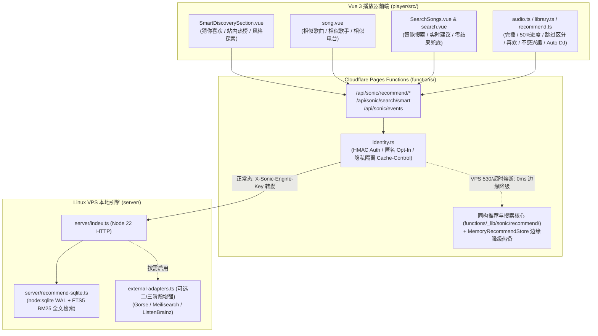

# CFSolara 智能音乐推荐与混合搜索引擎：系统架构、算法公式与运维手册

本文档详细说明 CFSolara 智能音乐推荐与混合搜索引擎的整体架构、跨平台曲目归一模型、热度与推荐数学公式、智能搜索相关性门控算法、API 契约、部署配置及三阶段演进路线。

---

## 1. 系统架构与数据流

系统遵循 **“Linux VPS 为主（计算与持久化）+ Cloudflare Pages / Functions 为辅（边缘网关、缓存隔离与熔断降级）”** 的同构双层设计：



---

## 2. 数据库表结构与统一曲目实体 (`CanonicalTrack`)

### 2.1 跨平台实体归一与误合并防护
在 [`track-canonical.ts`](file:///home/shijian/projects/CFSolara/functions/_lib/sonic/recommend/track-canonical.ts) 中，每首歌曲通过以下步骤生成确定性的 `canonicalTrackId` (`trk_<16hex>`)：
1. **版本自动识别 (`classifyTrackEdition`)**：在剥离括号修饰词前，先将曲目严格归类为 `studio | live | remix | cover | instrumental | acoustic | demo`；
2. **歌名与歌手归一**：繁体转简体（`toSimplifiedChinese`）、剥离音质/影视后缀、歌手中英文艺名归一（如 `Jay Chou` $\to$ `周杰伦`、`G.E.M.` $\to$ `邓紫棋`、`Eason Chan` $\to$ `陈奕迅`）；
3. **跨平台安全合并 (`canMergeCanonicalTracks`)**：仅当 `(cleanTitle, canonicalArtist, edition)` 完全一致且时长偏差 $\le 12\text{s}$（拒绝将 30 秒铃声与全曲合并）时，才将 `netease`、`qq`、`kugou`、`kuwo` 多源 ID 合并至同一 `CanonicalTrack`。

### 2.2 SQLite (WAL + FTS5) 持久化表结构 (`server/recommend-sqlite.ts`)
VPS 端使用 Node.js 22 内置 `node:sqlite` (`DatabaseSync`)，无需安装任何 C++ 原生依赖，默认持久化至 `/app/data/sonic-recommend.sqlite`：
- `canonical_tracks`：存储归一化曲目主键、拼音、首字母、流派、多平台 `sourceIds` 与 JSON 载荷；
- `platform_track_links`：`platform:platformId` 到 `canonical_track_id` 的快速索引；
- `tracks_fts`：**SQLite FTS5 全文检索引擎**（`unicode61` 分词 + CJK 单字/双字 Bigram + 全拼 + 拼音首字母 + 别名 token），支持毫秒级 `bm25()` 排序；
- `behavior_events`：存储用户/匿名设备行为事件（`event_id` 主键保证网络重试幂等，支持 90 天滑动窗口自动清理）；
- `track_cooccurrence`：维护会话级 Item-to-Item 曲目共现无向加权图；
- `search_queries`：统计脱敏搜索词频，用于搜索自动补全建议。

---

## 3. 核心推荐与热度算法数学模型

### 3.1 站内真实热度计算 (`popularity.ts`) 与三类指标严格分离
系统严格区分 **① 第三方平台热榜参考 (`externalChartScore`, `external-chart`)**、**② CFSolara 站内真实收听热度 (`internalScore`, `cfsolara-internal`)** 与 **③ 推荐系统预测的个人兴趣 (`personalized-interest` / `hybrid-personalized`)**。

对于站内真实收听事件，给定时间窗口半衰期 $\tau$（`24h` 榜 $\tau=12\text{h}$，`7d` 榜 $\tau=72\text{h}$）：
1. **单用户防刷对数封顶**：同一用户 $u$ 对曲目 $i$ 的时间衰减有效播放次数 $m_{u,i}$ 经过对数压缩：
   $$c(m_{u,i}) = 1 + 0.5 \ln(m_{u,i}) \quad (m_{u,i} \ge 1)$$
   单人循环刷播 100 次仅折算约 $3.30$ 次有效贡献，彻底杜绝单账号或脚本刷榜。
2. **贝叶斯平滑完播率与 Wilson 收藏率**：
   $$\text{CompRate}_i = \frac{C_i + \alpha_0 \mu_{\text{comp}}}{S_i + \alpha_0}, \quad \text{FavRate}_i = 0.6 \cdot \text{WilsonLowerBound}(F_i, U_i) + 0.4 \cdot \frac{F_i + \beta_0 \mu_{\text{fav}}}{U_i + \beta_0}$$
3. **小样本可信度修正与综合站内热度**：
   $$\text{Conf}_i = \frac{U_i}{U_i + k} \quad (k=5)$$
   $$\text{InternalScore}_i = \text{Conf}_i \cdot \left(0.35 \tilde{P}_i + 0.25 \tilde{U}_i + 0.20 \text{CompRate}_i + 0.15 \text{FavRate}_i + 0.05 \text{Velocity}_i\right) \cdot \text{FreshnessDampening}_i$$
   当曲目尚无站内真实播放时，`internalScore` 严格等于 `0`，绝不将外部榜单伪装为站内真实收听。

### 3.2 行为反馈可信度权重与网络异常保护 (`engine.ts`)
| 事件类型 (`type`) | 触发条件 | 权重 (`weight`) | 设计说明 |
| :--- | :--- | :---: | :--- |
| `favorite` / `unfavorite` | 点击红心收藏 / 取消收藏 | `+4.0` / `-1.5` | 最强显式正向偏好信号 |
| `replay` | 单曲循环重播完成 | `+3.5` | 强正向重复收听信号 |
| `play_complete` | 自然播放结束（非 30s 试听截断） | `+2.5` | 可靠正向完播信号 |
| `play_progress` | 播放进度 $\ge 50\%$ 或收听满 $45\text{s}$ | `+1.2 ~ +1.8` | 有效收听正向信号 |
| `search_click` / `search` | 搜索后点击播放结果 / 仅输入搜索词 | `+1.1` / `+0.3` | 搜索词仅作弱信号，点击并完播才放大权重 |
| `skip` (`network_stall` / `playback_error` / `trial_end`) | 网络卡顿、音源报错、VIP 30s 试听结束 | **`0.0`** | **绝不将网络卡顿、播放失败或试听结束误判为用户不喜欢** |
| `skip` (`user_skip`, $<25\text{s}$) | 正常播放状态下前 25 秒手动切歌 | `-0.8` | 弱负向信号 |
| `dislike` / `undislike` | 点击“减少类似推荐” / 撤销 | `-5.0` / `+0.5` | 强负向信号，立即从该用户推荐池屏蔽该曲并降低歌手权重 |

### 3.3 混合推荐动态权重重分配与 MMR 多样性重排
候选曲目综合得分由 5 个归一化分量构成：
$$S(u, i) = w_c \text{Content}(u,i) + w_b \text{Behavior}(u,i) + w_p \text{Pop}(i) + w_f \text{Freshness}(u,i) + w_x \text{Context}(i)$$
- **动态权重重分配**：当新用户无收听历史（`Behavior` 缺失）或无锚点歌曲（`Content` 缺失）时，系统自动将其权重重分配给其余可用信号并按 $\sum w = 1$ 归一，不会因某项信号缺失而压低总分。
- **MMR 最大边缘相关重排与硬上限**：
  $$\text{MMR}(i) = (1 - \lambda) S(u,i) - \lambda \max_{j \in R} \text{Sim}(i, j)$$
  同时强制执行单歌手上限（冷启动 $\le 2$ 首、个性化 $\le 3$ 首）、单专辑上限（$\le 2$ 首）与温度采样探索（`temperature` $\in [0.1, 1.5]$）。

---

## 4. 智能搜索引擎算法 (`smart-search.ts`)

搜索排序严格遵循 **“搜索意图与字面相关性第一 > 可播放性与原版优先 > 多源共识与适度热度 > 受门控的有界个性化微调”**：
1. **查询理解与扩展 (`expandQueryAliases`)**：
   - 繁体中文 $\to$ 简体中文（覆盖 340+ 常用音乐/人名繁简字对）；
   - 全拼与拼音首字母匹配（如 `qingtian` $\to$ 《晴天》，`zjl` $\to$ 周杰伦）；
   - 歌手中英文名/艺名双向映射（如 `jay chou` $\leftrightarrow$ 周杰伦、`g.e.m.` $\leftrightarrow$ 邓紫棋、`eason` $\leftrightarrow$ 陈奕迅）；
   - 拼写错误容忍（Damerau-Levenshtein 相邻换位编辑距离 $\le 2$，如 `coldpaly` $\to$ `Coldplay`、`tayler swift` $\to$ `Taylor Swift`）。
2. **相关性门控个性化（核心铁律）**：
   - 歌名+歌手精确匹配基础分 `1950`，歌名精确匹配 `1600`；
   - 个性化加分被严格门控：**仅当字面相关性得分 `relevance >= 600` 时才允许触发个性化微调，且个性化加分上限封顶为 `+85`**。
   - 因此，即便用户平时重度偏爱其他歌手，当其明确搜索《晴天》时，周杰伦《晴天》依然稳居第一，绝不会出现不相关歌曲反超精确匹配结果的情况。
3. **版本与可播放性优先级**：
   - 当用户未显式搜索 `live` / `伴奏` / `翻唱` 时，录音室原版（`studio`）优先于 `live` / `cover` / `instrumental`；
   - 完整可播放音源（`streamType: 'full'`）与多平台聚合音源优先于试听或不可用音源。
4. **零结果智能兜底**：
   - 当上游与本地索引均无匹配结果时，返回 `fallbackUsed: true` 与 `fallbackTracks`（可播放精选/个人偏好曲目）及纠错建议 `suggestions`，避免页面空白。

---

## 5. 新增 API 接口契约与调用示例

### 5.1 个性化与场景推荐：`GET /api/sonic/recommend/for-you`
- **参数**：
  - `mode`：`for-you`（默认猜你喜欢）| `recent`（基于最近收听）| `favorites`（基于收藏）| `next`（Auto DJ 下一首续接）| `radio`（单曲相似电台）
  - `count`：返回数量（默认 `18`，最大 `50`）
  - `seedTrackId` / `seedTitle` / `seedArtist`：`next` 或 `radio` 模式下的种子歌曲
  - `diversity`：多样性权重 `0.0 ~ 0.8`（默认 `0.28`）
  - `temperature`：探索温度 `0.1 ~ 1.5`（默认 `0.25`）
- **示例**：
  ```bash
  curl -s "http://127.0.0.1:8788/api/sonic/recommend/for-you?mode=for-you&count=6" \
    -H "X-Sonic-Anon-Id: anon_1234567890abcdef" | jq .
  ```

### 5.2 站内真实趋势热榜：`GET /api/sonic/recommend/trending`
- **参数**：
  - `window`：`24h` | `7d`（默认）| `all` | `surging`（飙升）| `new`（新歌）
  - `genre`：可选流派过滤（如 `r&b`、`rock`、`cantopop`、`mandopop`）
  - `personalized`：`1` 开启个人偏好加权热榜，`0` 纯公共热榜
- **示例**：
  ```bash
  curl -s "http://127.0.0.1:8788/api/sonic/recommend/trending?window=24h&count=10" | jq .
  ```

### 5.3 内容相似歌曲与相似歌手：`GET /api/sonic/recommend/similar`
- **参数**：`trackId`、`title`、`artist`、`album`、`count`（默认 `12`）、`includeSameArtist`（默认 `1`）
- **示例**：
  ```bash
  curl -s "http://127.0.0.1:8788/api/sonic/recommend/similar?title=%E6%99%B4%E5%A4%A9&artist=%E5%91%A8%E6%9D%B0%E4%BC%A6&count=6" | jq .
  ```

### 5.4 风格与温度探索雷达：`GET /api/sonic/recommend/discover`
- **参数**：`genre`、`language`（`zh` / `yue` / `en` / `ja` / `ko` / `inst`）、`temperature`（默认 `0.55`）、`count`

### 5.5 智能混合搜索与实时补全：`GET /api/sonic/search/smart`
- **参数**：
  - `q`：搜索关键词（支持简体、繁体、全拼、首字母、英文别名、拼写容错）
  - `mode`：`search`（默认完整搜索）| `suggest`（毫秒级搜索建议自动补全）
  - `personalize`：`1`（默认开启门控微调）| `0`（关闭个性化）
- **示例**：
  ```bash
  curl -s "http://127.0.0.1:8788/api/sonic/search/smart?q=qingtian&count=5" | jq .
  curl -s "http://127.0.0.1:8788/api/sonic/search/smart?mode=suggest&q=jay" | jq .
  ```

### 5.6 行为反馈上报与一键隐私清除：`POST / DELETE / GET /api/sonic/events`
- `POST /api/sonic/events`：上报单条或批量行为事件 `{ "events": [{ "type": "play_complete", "track": { ... } }] }`；
- `DELETE /api/sonic/events`：一键删除当前用户或 `X-Sonic-Anon-Id` 的全部服务端历史行为事件；
- 当请求头携带 `X-Sonic-Personalization: off` 时，服务端立即忽略所有写入并切换为纯公共无追踪模式。

---

## 6. 离线评估基准结果 (`npm run eval:recommend`)

通过运行 [`scripts/evaluate-recommendation.mjs`](file:///home/shijian/projects/CFSolara/scripts/evaluate-recommendation.mjs)（基于可复现合成多画像留一切分基准与 20 组多语言搜索测试集，明确区分于线上真实日志），实测指标如下：

| 评估维度 | 指标名称 | 实测数值 | 说明 |
| :--- | :--- | :---: | :--- |
| **推荐准确性** | `Precision@10` | **0.6333** | Top-10 推荐中命中留出验证集目标曲风/歌手的比例 |
| **推荐召回率** | `Recall@10` | **0.7056** | 留出验证集相关曲目的召回覆盖比例 |
| **排序质量** | `NDCG@10` | **0.7711** | 归一化折损累计增益（越靠前命中权重越高） |
| **目录覆盖率** | `CatalogCoverage` | **0.7586** | 6 类不同口味画像合计覆盖曲库 75.86% 的曲目，避免马太效应垄断 |
| **列表内多样性** | `IntraListDiversity (ILD)` | **0.7983** | 推荐列表内歌手与流派的两两异质性（0~1） |
| **搜索命中率** | `Top-1 / Top-5 Hit Rate` | **1.0000 / 1.0000** | 简繁、全拼、首字母、英文别名、拼写容错与精确匹配保护全部命中 |
| **零结果兜底** | `ZeroResultRate_AfterFallback` | **0.0000** | 极端无匹配查询 100% 触发可播放智能兜底 |
| **计算延迟与内存** | `p50 / p95 Latency` | **推荐 8.5ms / 搜索 2.8ms** | Node 22 + SQLite FTS5 单核 CPU 毫秒级响应，无需 GPU |

---

## 7. 部署、容量规划与演进路线

### 7.1 VPS 资源消耗估算与分级配置
| 硬件规格 | 适用规模 | 部署建议 |
| :--- | :--- | :--- |
| **1 核 1 GB RAM** | 个人 / 小团队（日活 $\le 500$） | 默认 Stage 1（`sonic-engine` + 内置 SQLite WAL/FTS5 + `ncm-api`），推荐模块仅额外占用约 `15~25 MB` 内存 |
| **2 核 2 GB RAM** | 中型站点（日活 $500 \sim 5,000$） | 默认 Stage 1 + 开启 `SONIC_ENABLE_LISTENBRAINZ=1` 相似歌手增强 |
| **2 核 4 GB+ RAM** | 大型站点（曲库 $> 10\text{万}$、高并发协同过滤） | 可选挂载 Stage 2 Gorse（`SONIC_GORSE_URL`）与 Stage 3 Meilisearch（`SONIC_MEILISEARCH_URL`） |

### 7.2 索引维护与数据备份
- **自动维护**：每次写入满 250 条事件自动执行 `90` 天过期事件清理（可通过 `SONIC_RECOMMEND_RETENTION_DAYS` 调整）；
- **备份**：仅需定期备份 Docker 卷 `sonic-data` 中的 `/app/data/sonic-recommend.sqlite` 文件（支持 SQLite 在线 `.backup`）。
